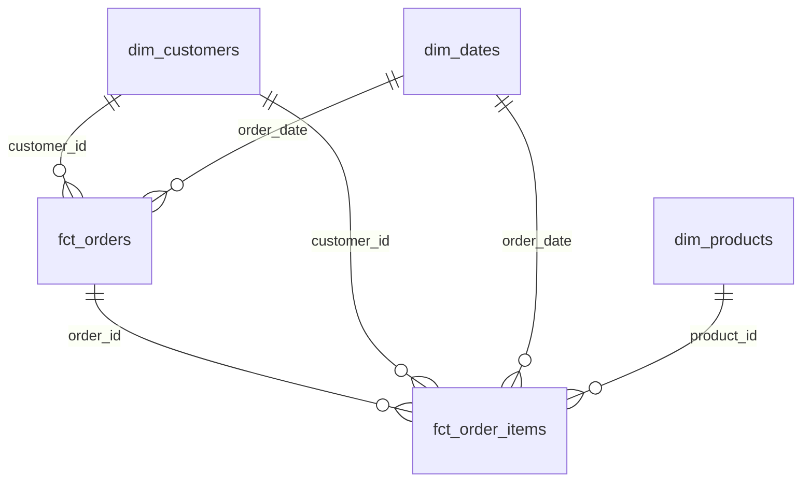
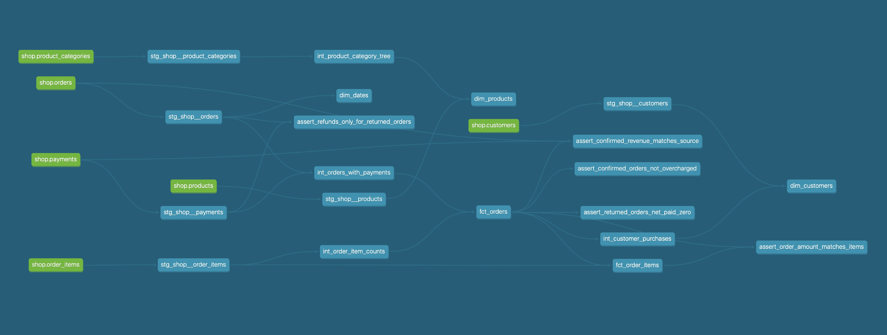

# DE ДЗ1. Аналитика интернет-магазина
Проект собирает в Greenplum витрины по заказам, товарам и клиентам.

## Модель данных

| Витрина | Строка| Пример |
| --- | --- | --- |
| fct_orders| Один заказ(без тестовых заказов) | Какая выручка по заказам за месяц? |
| fct_order_items | Одна товарная позиция заказа | Какие категории товаров принесли больше всего выручки? |
| dim_products| Один товар | В каком разделе находится товар? |
| dim_customers | Один клиент | Сколько заказов сделал клиент(подтвержденных)? |
| dim_dates| Один календарный день | В какие дни недели больше всего заказов? |

### Greenplum

| Витрина | Распределение | Обоснование|
| --- | --- | --- |
| fct_orders| DISTRIBUTED BY (order_id)| Храним заказ вместе с его позициями.|
| fct_order_items | DISTRIBUTED BY (order_id) | Все позиции одного заказа храним вместе.|
| dim_products | DISTRIBUTED REPLICATED | Товаров мало - храним копию на каждом сегменте. |
| dim_customers | DISTRIBUTED REPLICATED| Копия позволяет сразу найти клиента по заказу.|
| dim_dates| DISTRIBUTED REPLICATED| Календарь маленький - храним копию на каждом сегменте. |

В raw заказы, позиции и платежи тоже распределены по order_id. Если распределить таблицы фактов по разным ключам Greenplum надо будет переслать строки между сегментами.

### Граф зависимостей

### WARN 

По заказу 113 прошло два платежа по 200р при сумме заказа 200р - assert_confirmed_orders_not_overcharged отмечает двойное списание как WARN.